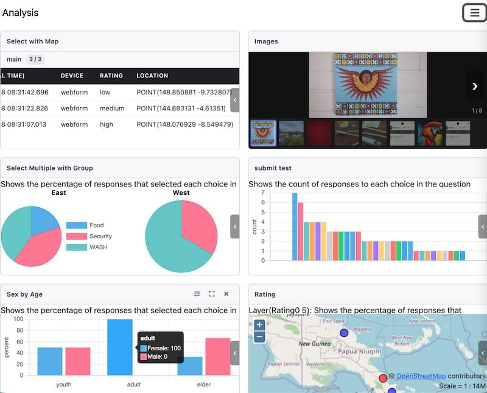
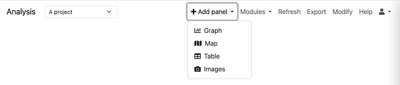
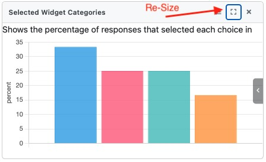
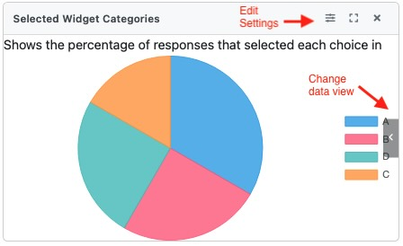
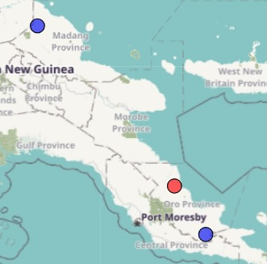
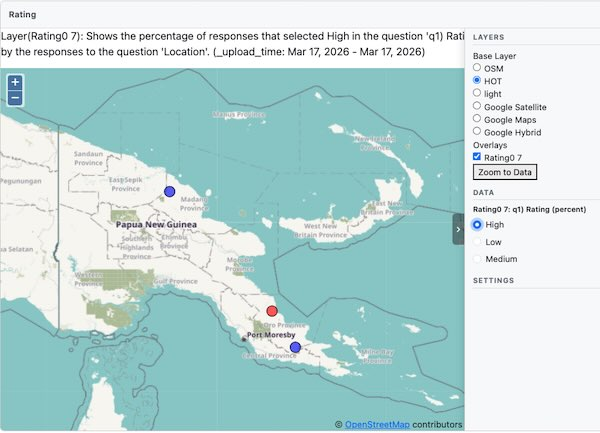
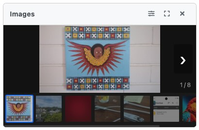

.. _dashboard:

Dashboard
=========

.. contents::
 :local:
 
The purpose of the dashboard is to give a quick insight into data for Quality
Assurance. Dashboards are also useful for providing a view of ongoing
operations. They are not a substitute for a data analysis system such as Excel
or a GIS.

Dashboards also do not have drill-down capability for problem identification.
If an anomaly is shown in a dashboard, an AI tool can be used to identify
cause and impact.

   An Example Smap Dashboard

Managing Panels
---------------

Panels have buttons at the top right to resize, edit settings, and delete.
These buttons are visible only when you hover over the panel.

Adding Panels
+++++++++++++

   
   Adding a Panel
   
Select **Add Panel**, then select one of the panel types: graph, table, map,
or image.

Resizing a Panel
++++++++++++++++

   
   Resizing a Panel

Panels can be shown in two sizes: expanded to the size of the screen, or
minimised so multiple panels can be viewed at once.
   
Editing a Panel
+++++++++++++++

   
   Editing a Panel
   
Clicking the settings icon opens the same dialog that was used to create the
panel. Clicking the "Data View" drawer opens a side panel that allows
selection of map layers or subforms in a survey. For a graph created from
select question responses, you can choose which options are shown.

Closing a Panel
+++++++++++++++

A panel can be closed by clicking the **X** at the top right.

Panel Settings
--------------

Subject
+++++++

For all panel types, the default subject is "Data". However, for table and
map panels, you can select one of:

*  Data
*  User Activity
*  User Locations

**Data** shows information collected for a specific survey, including answers
to survey-specific questions.

**User Activity** shows information about the activities of a specific user
for all surveys they have submitted. This information includes metadata about
each submission:

*  Location
*  Survey name
*  Upload Time
*  Start Time
*  End Time
*  Device
*  Comments on survey
*  Instance Name 
*  Scheduled Start (For tasks)

**User Locations**

For a map panel, this shows the location where each user last refreshed FieldTask.
Each user's location is shown as a coloured circle with their user ident in
red next to it. The circle colour depends on how long it has been since they
refreshed:

*  less than 1 hour - green
*  1 hour to 1.5 hours - yellow
*  1.5 hours to 2 hours - orange
*  2 hours or more - red

For a table panel, the last refresh time is shown for each user.

Only users who are members of the currently selected project will be shown.

To view user locations, you need the security groups ``analyst`` or
``view data``. If the user only has ``view data``, they are restricted to
viewing only the locations of users with the same security role, or users with
no security role if the dashboard user does not have one.

.. warning::

  If no location is available with the last refresh, the user will not be
  shown in either the map panel or the table panel.

Survey
++++++

Select the survey whose data you want to show. This option is used only with
the "Data" subject.

User
++++

Select the user whose activity you want to show. This option is used only with
the "User Activity" subject.

Include Read Only
+++++++++++++++++

Include read only questions in the panel's data.  This option is shown for
table and map panels with the "Data" subject.

Graph Panels
------------

After you select the survey, you must select a question to analyse on the
graph. Alongside each question, you can select the function that is applied to
the data. This can be either:

*  Percent (The percentage of responses with this value, or the percentage of
   responses within the group that had this value)
*  Count (Counts of responses with this value)

There are two graph types:

#.  Histograms (Shown as a Pareto chart - limited to the largest 30 values)
#.  Pie Charts

Data is shown as a time series if you select a time interval. For example, if
you select an interval of *week*, values are shown on a week-by-week basis.

Question types that can be graphed:

*  select one
*  select multiple
*  text
*  calculates
*  server calculations
*  integer
*  decimal

Map Panels
----------

Whole of Survey View
+++++++++++++++++++++

It is not necessary to select a question. Select the survey and save. The
resulting map shows all locations where data was collected. If you click a
point, details of the data at that point are shown.

If you have multiple location questions in a survey, you can select the
location question to show on the map.  Lines, such as those recorded by a
geotrace question, are drawn in blue.

User Activity Map
+++++++++++++++++

A map with the "User Activity" subject shows the locations of the user's
submissions.  Each point is numbered.  Where points are close together they
are combined into a cluster, which is labelled with up to three of the record
numbers followed by a count of the rest, for example "10, 9, 8 +3".  Zoom in
to separate the cluster or click it to see the records.

The map also shows the trail of locations recorded by FieldTask for that user
as a blue line.  The trail follows the panel's date range, or the dashboard
date range if the panel does not have one.

Show On
+++++++

By default a map panel is shown on its own map, "This Map".  Alternatively
select another map panel to show this panel's data as a layer on that map.
Only map panels that are not themselves shown on another map are listed.

Map view of a select question
+++++++++++++++++++++++++++++

When creating the map panel, specify a question to analyse. This works best
for ``select_one`` or ``select_multiple`` question types.

   
   Question level map view

The locations are colour coded according to relative frequency:

*  Red: High
*  Orange
*  Yellow
*  Green
*  Blue: Low

These frequency values apply to one of the choices in the question. To view
the results for a different choice, select that choice in the drawer to the
right of the map.

If a location contains only a single record, it is coloured "red" if the choice
was selected, or "blue" if the choice was not selected. However, if you have
more than one record clustered at a single location, you will see the range of
colours described above, depending on the percentage of times that choice was
selected.

   
   Question level map view zoomed out to show clustering

Time Series Map
+++++++++++++++

When a question is selected you can also set **Time Series** to hour, day,
week, month or year.  The records are then grouped into periods of that length
using the panel's date question, and the map shows a window of one or more periods.

Controls below the map select which periods are shown:

*  **Interval** - how many periods are shown at once
*  **Start** - play the periods in order, as an animation
*  the slider - move to a period

The dates of the periods shown are displayed next to the **Start** button.
Points are coloured and clustered in the same way as a map without a time
series.

Table Panels
------------

Table panels are useful for viewing all data collected in a survey. They show
200 records at a time, and you can page through all records using the
next **>>>** and previous **<<<** buttons.

If you open the drawer on a table panel, you can apply actions to the data,
such as backing it up or importing new data. Refer to :doc:`analysis-archive`,
:doc:`analysis-delete-restore`, and :doc:`analysis-backup`.

Bad Records
+++++++++++

Records that have been deleted are marked as "Bad". These are shown in table panels with a light red background.  No other panels use
bad or deleted records; for example, graphs do not include data from deleted records.

A user can toggle a record from good to bad and back again.  To do this, right click on the cell in the "Bad" column for the record
and then provide a "Reason" in the dialog.

Record Level Operations
+++++++++++++++++++++++

Each record has a menu shown as an ellipsis.  Clicking it opens a dialog where the user can:

*  edit the data
*  download a PDF of the record
*  show the record in an expanded view, with each question on its own line

Image panels
------------

Image panels show the images in a survey.  Thumbnails are shown at the bottom of the panel; select one
to see the full size image.

   An image panel

Filters
-------

You can apply filters. This can include a date range filter, where you select
the date question and then choose start and end dates. You can also specify an
**advanced** filter for data values.

Dashboard Date Range
++++++++++++++++++++

Available from SmapServer v26.06.  The date range selector in the menu bar applies a relative date range to every panel that
does not have a date range of its own: **All**, **Last day**, **Last week** or **Last month**.  This keeps a dashboard showing
recent data without having to edit the dates of each panel.  The selection is remembered for you in your browser.

Managing Another User's Dashboard
---------------------------------

Available from SmapServer v26.06.  Administrators see a **Manage panels for** selector in the menu bar listing the users who
have access to the current project.  Select a user to see their dashboard and add, change or remove their panels, for example
to set up a dashboard for somebody.  Select yourself to return to your own dashboard.

Automatic Refresh
-----------------

This can be enabled by an organisational administrator in the
:ref:`organisation-admin-settings` tab of the settings page. Setting a value of
zero disables auto refresh. Otherwise, you can specify the refresh interval in
minutes.

Only graphs, maps and "User Locations" tables are refreshed automatically.
