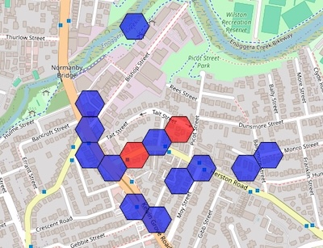

.. _dashboard:

Dashboard
=========

.. contents::
 :local:
 
The purpose of the dashboard is to give a quick insight into data for Quality
Assurance. Dashboards are also useful for providing a view of ongoing
operations. They are not a substitute for a data analysis system such as Excel
or a GIS.

Dashboards also do not have drill-down capability for problem identification.
If an anomaly is shown in a dashboard, an AI tool can be used to identify
cause and impact.

.. figure::  _images/dashboard.jpg
   :align:   center
   :width:   600px
   :alt:     A dashboard with multiple panels of different types including a table, graph, image and map

   An Example Smap Dashboard

Managing Panels
---------------

Panels have buttons at the top right to resize, edit settings, and delete.
These buttons are visible only when you hover over the panel.

Adding Panels
+++++++++++++

.. figure::  _images/analysis1.jpg
   :align:   center
   :width:   500px
   :alt:     Adding a Panel
   
   Adding a Panel
   
Select **Add Panel**, then select one of the panel types: graph, table, map,
or image.

Resizing a Panel
++++++++++++++++

.. figure::  _images/analysis2.jpg
   :align:   center
   :width:   500px
   :alt:     Resizing a Panel
   
   Resizing a Panel

Panels can be shown in two sizes: expanded to the size of the screen, or
minimised so multiple panels can be viewed at once.
   
Editing a Panel
+++++++++++++++

.. figure::  _images/analysis3.jpg
   :align:   center
   :width:   300px
   :alt:     Editing a Panel
   
   Editing a Panel
   
Clicking the settings icon opens the same dialog that was used to create the
panel. Clicking the "Data View" drawer opens a side panel that allows
selection of map layers or subforms in a survey. For a graph created from
select question responses, you can choose which options are shown.

Closing a Panel
+++++++++++++++

A panel can be closed by clicking the **X** at the top right.

Panel Settings
--------------

Subject
+++++++

For all panel types, the default subject is "Data". However, for table and
map panels, you can select one of:

*  Data
*  User Activity
*  User Locations

**Data** shows information collected for a specific survey, including answers
to survey-specific questions.

**User Activity** shows information about the activities of a specific user
for all surveys they have submitted. This information includes metadata about
each submission:

*  Location
*  Survey name
*  Upload Time
*  Start Time
*  End Time
*  Device
*  Comments on survey
*  Instance Name 
*  Scheduled Start (For tasks)

**User Locations**

For a map panel, this shows the location where each user last refreshed FieldTask.
Each user's location is shown as a coloured circle with their user ident in
red next to it. The circle colour depends on how long it has been since they
refreshed:

*  less than 1 hour - green
*  1 hour to 1.5 hours - yellow
*  1.5 hours to 2 hours - orange
*  2 hours or more - red

For a table panel, the last refresh time is shown for each user.

Only users who are members of the currently selected project will be shown.

To view user locations, you need the security groups ``analyst`` or
``view data``. If the user only has ``view data``, they are restricted to
viewing only the locations of users with the same security role, or users with
no security role if the dashboard user does not have one.

.. warning::

  If no location is available with the last refresh, the user will not be
  shown in either the map panel or the table panel.

Survey
++++++

Select the survey whose data you want to show. This option is used only with
the "Data" subject.

User
++++

Select the user whose activity you want to show. This option is used only with
the "User Activity" subject.

Include Read Only
+++++++++++++++++

Include read only questions in the panel's data.  This option is shown for
table and map panels with the "Data" subject.

Graph Panels
------------

After you select the survey, you must select a question to analyse on the
graph. Alongside each question, you can select the function that is applied to
the data. This can be either:

*  Percent (The percentage of responses with this value, or the percentage of
   responses within the group that had this value)
*  Count (Counts of responses with this value)

There are two graph types:

#.  Histograms (Shown as a Pareto chart - limited to the largest 30 values)
#.  Pie Charts

Data is shown as a time series if you select a time interval. For example, if
you select an interval of *week*, values are shown on a week-by-week basis.

Question types that can be graphed:

*  select one
*  select multiple
*  text
*  calculates
*  server calculations
*  integer
*  decimal

Map Panels
----------

Whole of Survey View
+++++++++++++++++++++

It is not necessary to select a question. Select the survey and save. The
resulting map shows all locations where data was collected. If you click a
point, details of the data at that point are shown.

If you have multiple location questions in a survey, you can select the
location question to show on the map.  Lines, such as those recorded by a
geotrace question, are drawn in blue.

User Activity Map
+++++++++++++++++

A map with the "User Activity" subject shows the locations of the user's
submissions.  Each point is numbered.  Where points are close together they
are combined into a cluster, which is labelled with up to three of the record
numbers followed by a count of the rest, for example "10, 9, 8 +3".  Zoom in
to separate the cluster or click it to see the records.

The map also shows the trail of locations recorded by FieldTask for that user
as a blue line.  The trail follows the panel's date range, or the dashboard
date range if the panel does not have one.

Show On
+++++++

By default a map panel is shown on its own map, "This Map".  Alternatively
select another map panel to show this panel's data as a layer on that map.
Only map panels that are not themselves shown on another map are listed.

Map view of a select question
+++++++++++++++++++++++++++++

When creating the map panel, specify a question to analyse. This works best
for ``select_one`` or ``select_multiple`` question types.

.. figure::  _images/analysis5.jpg
   :align:   center
   :width:   300px
   :alt:     Showing a map view that shows results for a selected question
   
   Question level map view

The locations are colour coded by the share of their records that have the
selected choice:

*  Red: all of them
*  Orange
*  Yellow
*  Green
*  Blue: none of them

The colours apply to one of the choices in the question. To view the results
for a different choice, select that choice in the drawer to the right of the
map.

A location with a single record is coloured red if the choice was selected, or
blue if it was not.  A cluster of records, or an area when the map is grouped
by regions, is coloured according to the percentage of its records where the
choice was selected.

.. figure::  _images/analysis6.jpg
   :align:   center
   :width:   300px
   :alt:     Showing a map view with clustering
   
   Question level map view zoomed out to show clustering

Group by Regions
++++++++++++++++

Requires Smap Server version 26.11+.

A map with a question can group its records by area instead of showing each location.  Each area
is then coloured by the share of its records that have the selected choice, in the same way as a
cluster of points: red if all of them have it, blue if none do, and orange, yellow or green in
between.  This gives a quick picture of where an answer is common, for example the share of
households in each district that report a problem.

A map without a question can also be grouped by area.  Each area then shows how many records it
holds, coloured from blue for the area with the fewest records to red for the area with the most.

   Record Heatmap on a hexagonal grid

Two kinds of area can be used:

*  **Hex grids** - a grid of equal sized hexagons that you create over part of the map
*  **Polygons** - the shapes recorded by a geoshape question in the survey, or in another survey
   in its bundle, such as the boundaries of farms, villages or districts

Each record is placed using the panel's location question, the one selected for the map in the
panel's settings.

Choosing the Regions
^^^^^^^^^^^^^^^^^^^^

Set **Group by** to a grid or a polygon question.  This can be done in either of two places:

*  the panel's settings, where **Group by** lists the grids under **Hex grids** and the geoshape
   questions under **Polygons**.  A question in another survey of the bundle is shown with the
   name of its survey.
*  the drawer on the map panel, under **Regions**.  A change made here is saved straight away and
   the map is redrawn.

When a polygon question is selected, also set **Label** to the question whose answer names each
shape, for example the name of the farm.  Without a label the shapes are named by their record
number.

Set **Group by** to **None** to show the records as points again.

Creating a Hex Grid
^^^^^^^^^^^^^^^^^^^

Analysts and administrators can create grids:

#.  Open the drawer on a map panel for the survey and go to **Regions**.
#.  Zoom and pan the map until it shows the area the grid should cover.
#.  Enter a name for the grid and the cell size in metres.  The cell size is the length of a
    side of each hexagon.
#.  Select **Create**.  The grid is added to the **Group by** lists.

The whole area showing on the map is covered, including places that have no data yet, so data
submitted later is counted too.  You can create as many grids as you need, for example a coarse
grid over the whole project area and a fine grid over a town where there are many records.

A grid can have up to 20,000 cells.  If there would be more, use a larger cell size or zoom in to
a smaller area.

To delete a grid, select **Delete** next to it in the drawer and then select it again to confirm.
A panel that was grouped by that grid goes back to showing points.

Grids belong to the survey and to the other surveys in its bundle, and can be used by any of
their map panels.  They are deleted when the last survey in the bundle is erased.

Using Polygons from Surveys
^^^^^^^^^^^^^^^^^^^^^^^^^^^

Any geoshape question in the survey, or in another survey in the same bundle, can be used.  The
shapes can be collected with the other data, for example by recording each farm boundary once in
a record of its own, or in a separate survey of boundaries that is added to the bundle.  Only the
surveys that you have access to are listed.

*  The label question must be in the same form, of the same survey, as the geoshape question.
*  Deleted (bad) records are not used as shapes.
*  If your roles restrict the records you can see in the survey that holds the shapes, only the
   shapes in those records are used.

Colours and Details
^^^^^^^^^^^^^^^^^^^

Choose the answer that the colours show in the drawer, in the same way as for points.  Click an
area to see its details, including the percentage or count of its records with that answer.

*  Records that are outside every area are not shown.
*  A record inside two overlapping shapes is counted in both.
*  Areas with no records are not drawn.
*  Grouping by area also works with a time series, the areas then show the records in the
   periods selected.

Time Series Map
+++++++++++++++

When a question is selected you can also set **Time Series** to hour, day,
week, month or year.  The records are then grouped into periods of that length
using the panel's date question, and the map shows a window of one or more periods.

Controls below the map select which periods are shown:

*  **Interval** - how many periods are shown at once
*  **Start** - play the periods in order, as an animation
*  the slider - move to a period

The dates of the periods shown are displayed next to the **Start** button.
Points are coloured and clustered, or grouped by region, in the same way as a
map without a time series.

Table Panels
------------

Table panels are useful for viewing all data collected in a survey. They show
200 records at a time, and you can page through all records using the
next **>>>** and previous **<<<** buttons.

If you open the drawer on a table panel, you can apply actions to the data,
such as backing it up or importing new data. Refer to :doc:`analysis-archive`,
:doc:`analysis-delete-restore`, and :doc:`analysis-backup`.

Bad Records
+++++++++++

Records that have been deleted are marked as "Bad". These are shown in table panels with a light red background.  No other panels use
bad or deleted records; for example, graphs do not include data from deleted records.

A user can toggle a record from good to bad and back again.  To do this, right click on the cell in the "Bad" column for the record
and then provide a "Reason" in the dialog.

Record Level Operations
+++++++++++++++++++++++

Each record has a menu shown as an ellipsis.  Clicking it opens a dialog where the user can:

*  edit the data
*  download a PDF of the record
*  show the record in an expanded view, with each question on its own line

Image panels
------------

Image panels show the images in a survey.  Thumbnails are shown at the bottom of the panel; select one
to see the full size image.

.. figure::  _images/analysis7.jpg
   :align:   center
   :width:   300px
   :alt:     Showing an image panel

   An image panel

Filters
-------

You can apply filters. This can include a date range filter, where you select
the date question and then choose start and end dates. You can also specify an
**advanced** filter for data values.

Dashboard Date Range
++++++++++++++++++++

Available from SmapServer v26.06.  The date range selector in the menu bar applies a relative date range to every panel that
does not have a date range of its own: **All**, **Last day**, **Last week** or **Last month**.  This keeps a dashboard showing
recent data without having to edit the dates of each panel.  The selection is remembered for you in your browser.

Managing Another User's Dashboard
---------------------------------

Available from SmapServer v26.06.  Administrators see a **Manage panels for** selector in the menu bar listing the users who
have access to the current project.  Select a user to see their dashboard and add, change or remove their panels, for example
to set up a dashboard for somebody.  Select yourself to return to your own dashboard.

Automatic Refresh
-----------------

This can be enabled by an organisational administrator in the
:ref:`organisation-admin-settings` tab of the settings page. Setting a value of
zero disables auto refresh. Otherwise, you can specify the refresh interval in
minutes.

Only graphs, maps and "User Locations" tables are refreshed automatically.
